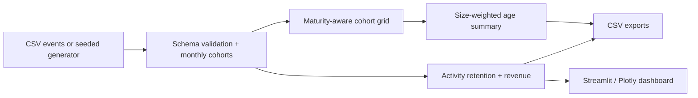

# Cohort Retention Lab 📈

[](https://github.com/nazirreally/cohort-retention-lab/actions/workflows/ci.yml)


**Reproducible SaaS activity analytics with censoring-aware cohort retention, cohort revenue, weighted retention, and an interactive dashboard.** All default data is synthetic; no credentials or proprietary software required.

## Business problem

Raw cohort tables frequently confuse **zero retention** with **not yet observable**. This project explicitly fills zero-activity months only when a cohort has matured to that age, and excludes immature cohorts from age-level comparisons. It also reports monthly recognized revenue and ARPU, rather than mislabeling activity as contractual churn.

## Architecture



## Technology stack

| Layer | Implementation |
|---|---|
| Analytics | Python, pandas, NumPy |
| CLI | argparse, installed `cohortlab` command |
| Visualization | Streamlit, Plotly |
| Testing | pytest, synthetic deterministic fixtures |
| Automation | GitHub Actions, Python 3.10 / 3.12 |

## Implemented features

- Seeded synthetic customer activity and custom CSV ingestion.
- Input validation for required columns, dates, identifiers, and nonnegative revenue.
- Unique-customer cohort activity retention (reactivation permitted).
- Cohort revenue, monthly recognized revenue, and ARPU.
- **Maturity-aware retention grid:** missing mature months count as zero, future/unobserved months are omitted.
- **Cohort-size-weighted retention** by age, using only eligible cohorts.
- Optional `--as-of` observation cutoff and `--max-age` horizon.
- CSV exports and a Streamlit dashboard with maturity-aware heatmap, cohort-size-weighted retention curve, observation cutoff, age horizon, and revenue views.

## Dashboard walkthrough

Upload an events CSV or use the seeded sample, select an observation cutoff, and adjust the maximum cohort age (0–24 months). The heatmap distinguishes mature zero-activity months from future cells, while the weighted curve uses only eligible cohorts at each age. Revenue and customer KPIs respect the selected cutoff. Download the maturity grid, weighted summary, or monthly revenue from the dashboard. These charts measure observed activity, not subscription cancellation.

## Setup and reproducible demo

Requires Python 3.10+. On macOS/Linux:

```bash
python -m venv .venv
source .venv/bin/activate
python -m pip install -e '.[dashboard,test]'
python -m pytest -q
cohortlab --seed 42 --max-age 6 --out outputs
streamlit run dashboard.py
```

On Windows PowerShell, activate with `.venv\\Scripts\\Activate.ps1`. For your own events:

```bash
cohortlab --input data/your_events.csv --as-of 2024-06 --max-age 3 --out outputs
```

Input columns: `customer_id,event_date,revenue`; revenue is a nonnegative numeric amount. `--as-of` must not be later than the latest observed event month.

Six generated CSV files: `events.csv`, `retention.csv`, `cohort_revenue.csv`, `monthly_metrics.csv`, `mature_retention.csv`, and `weighted_retention.csv`.

### Interpreting the new outputs

`mature_retention.csv` includes `cohort,age,cohort_size,active_users,retention_rate,as_of`. Example: if a January cohort has no February events but March events exist, February is **zero**, not missing. A cohort first seen in March cannot contribute an age-2 observation to a dataset ending in April.

`weighted_retention.csv` includes `age,eligible_cohorts,eligible_users,active_users,weighted_retention`. Each age uses the eligible customer population as its denominator; the average is **not** an unweighted mean of cohort percentages.

## Repository structure

```text
src/cohortlab/
  core.py         # validated cohort and revenue calculations
  maturity.py     # maturity-aware retention and weighted summaries
  generate.py     # synthetic events
  cli.py          # six CSV exports
dashboard.py      # Streamlit visualization
tests/            # pytest regression tests
.github/workflows/ci.yml
```

## Verification

Seven maturity-specific tests were reported passing in an earlier local run. For this dashboard update, Python syntax compilation passed locally; the full test suite, live Streamlit startup, and GitHub Actions results have **not** been verified. CI is configured for pytest and a CLI smoke test on Python 3.10 and 3.12; consult the linked workflow for its current status. No dashboard screenshot or performance benchmark is claimed.

## Engineering trade-offs and limitations

- A cohort is the month of **first observed event**, not necessarily signup or acquisition.
- Retention measures observed activity; it is **not** subscription survival or contractual churn.
- The latest observed event month is the default observation boundary. Sparse late data can make some apparently mature months zero; supply a deliberate `--as-of` for controlled reporting.
- The dashboard presents maturity-aware heatmap and weighted retention panels; it has not been browser-smoke-tested in this update.
- Input events are not deduplicated by event ID; revenue assumes events represent recognized amounts, without refunds, FX, or tax handling.
- pandas in-memory processing is suitable for portfolio/demo datasets, not massive streaming workloads.

## Roadmap

- Add automated Streamlit browser smoke tests and visual regression checks.
- Add data-quality diagnostics, explicit event IDs, and duplicate detection.
- Add DuckDB/Parquet input for larger reproducible workloads.
- Add integration tests for dashboard startup and CSV schema contracts.

**License:** Check repository license metadata before reuse; no license is implied by this README.
